<p align="center">
  <picture>
    <source media="(prefers-color-scheme: dark)" srcset="assets/hero-dark.svg">
    
  </picture>
</p>

<p align="center">
  <a href="#how-it-works">How it works</a> ·
  <a href="#results">Results</a> ·
  <a href="#install">Install</a> ·
  <a href="benchmark/README.md">Benchmark</a>
</p>

`converge-review` is a Claude Code skill. It sends one pinned patch to four independent reviewers, merges what they find, ranks it by how many of them agree, and fixes it behind red tests. It stops when a fresh re-review of the fixes comes back clean, or after three fix rounds.

On 50 pull requests from 5 repositories in Martian's Code Review Bench it found about 15 true issues per pull request. Five other review tools found 3 to 5. These results are provisional: the issues were checked by Claude models only.

## How it works

<p align="center">
  <picture>
    <source media="(prefers-color-scheme: dark)" srcset="assets/loop-dark.svg">
    
  </picture>
</p>

1. **Pin the patch.** The whole change is written to one patch file. Every reviewer reads that file and nothing else.
2. **Review blind.** Four seats run in parallel and never see each other's findings.

   | Seat | Role | Looks for |
   | --- | --- | --- |
   | `open-code-review` | correctness | bugs, security, error handling, concurrency |
   | `superpowers` | correctness | bugs, plan alignment, tests, production risk |
   | `ponytail` | advisory | over-engineering |
   | `mattpocock` | advisory | spec compliance, documented standards |

3. **Merge and rank.** Duplicates are merged. A finding raised by three or more seats goes on the main list. One raised by one or two seats goes on the appendix. Agreement ranks importance, not truth.
4. **Fix behind a red test.** The main list is fixed first, then the appendix. Each Critical or Important fix starts with a test, or a repro command, that fails on the patched code.
5. **Re-review the fixes only.** Fresh agents on the correctness seats check the fix diff. If anything is open, another fix round runs. The cap is three fix rounds, and hitting the cap is reported as not converged.

The project's own checks (tests, linters, type checker) run before the first round and after every fix. The orchestrator never reviews code itself. The full procedure is in [`skills/converge-review/SKILL.md`](skills/converge-review/SKILL.md).

Run it in Claude Code with:

```text
/converge-review
```

It is manual only; Claude will not start it on its own.

## Results

<p align="center">
  <picture>
    <source media="(prefers-color-scheme: dark)" srcset="assets/results-dark.svg">
    
  </picture>
</p>

Every tool's review comments on the 50 pull requests were pooled with the benchmark's own labels and merged into 1,109 distinct issues. Each issue was then checked against the source by a fresh agent that did not know which tool raised it. 990 were confirmed.

- **It finds more.** About 15 true issues per pull request, against 3 to 5 for the other tools.
- **Its comments are usually right.** 96% of its comments are true, against 84 to 94% for the others.
- **Many of its findings are small.** About 4 in 10 of its true findings are rated trivial. Counting only issues above trivial, 58% of its comments qualify, against 71 to 84% for four of the five other tools. It wins by finding more, not by being more precise.
- **The benchmark's own score ranks it 21st of 23** on F1 (Opus judge). The benchmark labels about 3 issues per pull request and counts every other comment as wrong. Its labels cover 149 of the 990 confirmed issues.

<details>
<summary>The numbers as a table</summary>

| Tool | True issues per PR | Above trivial per PR | Comments that are true | Comments true and above trivial |
| --- | ---: | ---: | ---: | ---: |
| **converge-review** | **14.8** | **8.9** | **96.3%** | **58.4%** |
| CodeRabbit | 4.9 | 3.2 | 84.3% | 55.0% |
| Augment | 3.2 | 2.7 | 92.1% | 77.0% |
| Claude Code | 3.0 | 2.4 | 94.2% | 75.1% |
| Cubic v2 | 2.8 | 2.3 | 86.3% | 70.9% |
| Qodo Extended v2 | 2.8 | 2.5 | 92.1% | 83.6% |
| Benchmark's own labels | 3.0 | 2.3 | 88.4% | 69.4% |

Primary verifier `claude-fable-5-2`. Source: [`results.json`](benchmark/experiments/005-pooled-truth/results.json), key `fable`.

</details>

### Limits

- **Provisional.** Every issue was verified by Claude models, and the four reviewers are Claude too. That is either a real result or a model marking its own homework. A check with an OpenAI model is in progress, and help with it is wanted; see the [validation protocol](benchmark/validation/README.md).
- **Only review and merge were measured.** The benchmark stops after the merge step. Whether the fix loop works is not measured. The benchmarked skill text reported the same findings without the main list and appendix split.
- **One run.** One review run, one merge, one verification run per verifier. Run-to-run variance is not known.
- **Cost.** 183.81 USD for the 50 pull requests on `claude-opus-5-5`, about 3.68 USD per pull request.

Details: [findings](benchmark/docs/findings.md) and [experiment 005](benchmark/docs/experiments/005-pooled-truth.md). The full harness and data are in [`benchmark/`](benchmark/), and [`benchmark/README.md`](benchmark/README.md) explains how to replicate the run.

## Install

Or simply tell your agent to install https://github.com/jakob1379/converge-review.

### Nix

Copy the skill and its four seat skills into `~/.claude/skills`:

```sh
nix run github:jakob1379/converge-review
```

Set `CLAUDE_SKILLS_DIR` to install somewhere else. Existing skill folders are kept, not overwritten. The `open-code-review` seat also needs the `ocr` binary on your `PATH`:

```sh
nix profile install github:jakob1379/converge-review#open-code-review
```

### home-manager

Add the flake as an input and import the module. It links the five skills into `~/.claude/skills` and installs `ocr`.

```nix
{
  inputs.converge-review.url = "github:jakob1379/converge-review";

  # in your home-manager configuration
  imports = [ inputs.converge-review.homeManagerModules.default ];
}
```

### Without Nix

Copy [`skills/converge-review`](skills/converge-review) into `~/.claude/skills/`, then install the four seats from their own repositories:

| Seat | Source |
| --- | --- |
| `open-code-review` | [alibaba/open-code-review](https://github.com/alibaba/open-code-review), the `plugins/open-code-review/claude-code` folder, plus the `ocr` binary |
| `superpowers` | [obra/superpowers](https://github.com/obra/superpowers) |
| `ponytail` | [DietrichGebert/ponytail](https://github.com/DietrichGebert/ponytail) |
| `mattpocock` | [mattpocock/skills](https://github.com/mattpocock/skills) |

### Development shell

`nix develop` gives Claude Code, Codex, `ocr`, `python3`, `uv` and `git`.

## License

MIT, see [`LICENSE`](LICENSE). The upstream benchmark, the five target repositories and the four seat skills keep their own licences.
